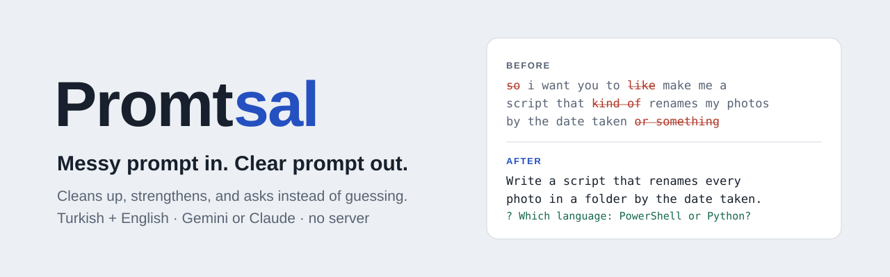
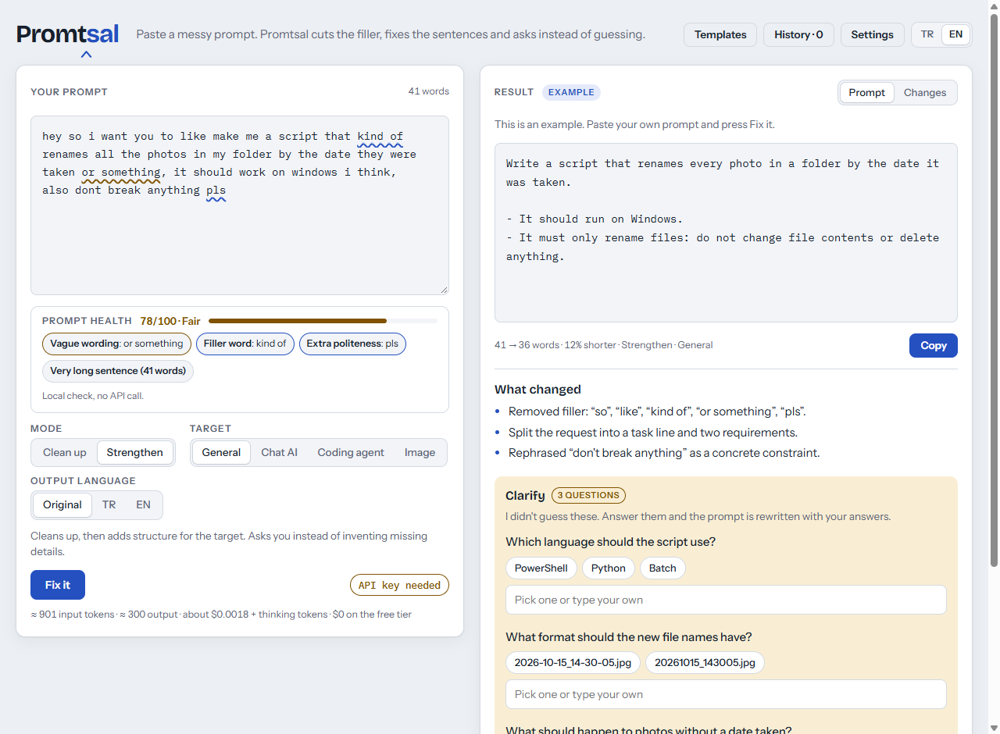
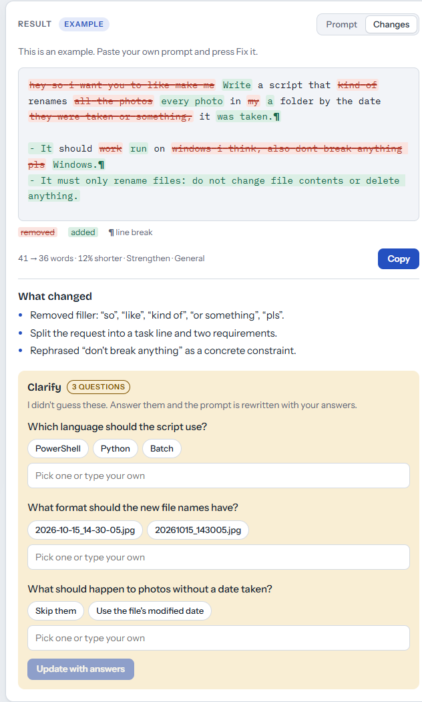
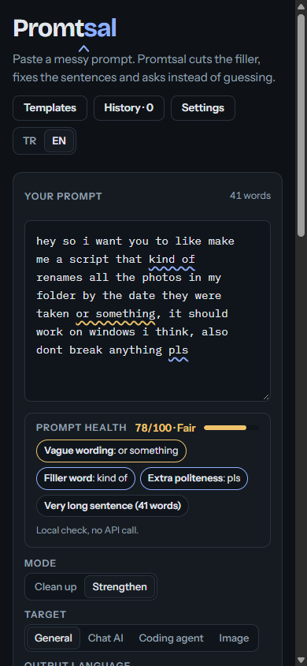
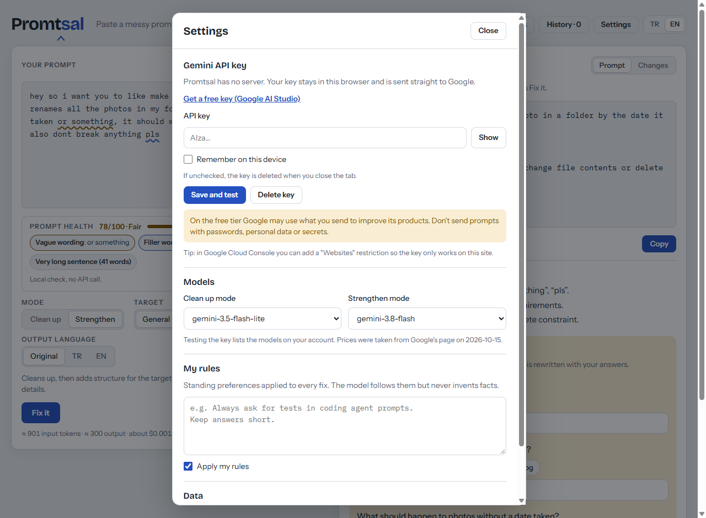

<div align="center">



**Promtsal turns a messy prompt into a clear one. It cuts the filler, fixes the sentences, and asks you about missing details instead of guessing them.**

[](https://cafu1107.github.io/promtsal/)

[](https://github.com/Cafu1107/promtsal/actions/workflows/pages.yml)
[](https://github.com/Cafu1107/promtsal/releases/latest)
[](LICENSE)


English · [Türkçe](README.tr.md)

</div>



## Quick start

1. Open **[cafu1107.github.io/promtsal](https://cafu1107.github.io/promtsal/)**.
2. Get a free Gemini API key from [Google AI Studio](https://aistudio.google.com/apikey) and paste it in **Settings**.
3. Paste your prompt and press **Fix it** (or <kbd>Ctrl</kbd> + <kbd>Enter</kbd>).

## Features

| ✂️ Clean up or strengthen | ❓ Asks, doesn't guess | 🩺 Prompt health |
| --- | --- | --- |
| **Clean up** fixes typos, filler and repetition and adds nothing. **Strengthen** also restructures the prompt for the target AI. | Missing details come back as questions with suggested answers. Answer them and the prompt is rewritten with your answers. | A local check, with no API call, underlines filler, vague and repeated words as you type and gives a 0–100 score. |
| 🎯 **Targets** | 🔍 **Every change visible** | 🔐 **Your key stays with you** |
| General, chat assistants, coding agents (Claude Code, Cursor, Codex) and image generators (Midjourney, Flux, Higgsfield). | The Changes tab strikes through removed words and highlights added ones. A short list says what changed and why. | There is no server. The key goes from your browser straight to Google and is kept only for the session unless you choose to remember it. |
| 📋 **Templates and rules** | 💰 **Tokens and cost** | 🌐 **Turkish and English** |
| Built-in templates (bug, feature, code review, summary, email, comparison, image) plus your own. Standing rules apply to every fix. | An estimate before you send, and the real token usage and cost after. | Interface in Turkish or English. Output in the original language or translated. |

## Screenshots

| Changes view | Phone, dark theme | Settings |
| --- | --- | --- |
|  |  |  |

## Privacy and security

- **No server, no tracking.** Promtsal is a static page on GitHub Pages. Prompts and the key go only to `generativelanguage.googleapis.com`.
- **The key is yours.** It lives in `sessionStorage` and disappears when you close the tab. It moves to `localStorage` only if you tick **Remember on this device**. One click deletes it.
- **Locked-down page.** A strict Content Security Policy allows no other network destination, no inline or third-party scripts, and no `eval`. Trusted Types are enforced and nothing is rendered as HTML.
- **Checked on every push.** CI runs the tests, verifies those rules, and scans the repository for leaked keys before deploying.

Details and how to report a problem: [SECURITY.md](SECURITY.md).

## FAQ

<details>
<summary><b>Is it free?</b></summary>

Promtsal is free. The Gemini API has a free tier with daily limits, which is usually enough for prompt editing. If you use a paid key, the page shows an estimate before you send and the real cost after, using Google's published prices (they were last checked on 2026-10-15 and may change).
</details>

<details>
<summary><b>What does Google do with my prompts?</b></summary>

On the **free tier**, Google says it may use what you send to improve its products. On the paid tier it doesn't. Don't send passwords, personal data or secrets either way.
</details>

<details>
<summary><b>It says my key is invalid or blocked.</b></summary>

Check that you copied the whole key from AI Studio. If you added a **Websites** restriction in Google Cloud Console, it must include `https://cafu1107.github.io/*`.
</details>

<details>
<summary><b>Can I use Claude or OpenAI instead?</b></summary>

The website uses Gemini. The same code also builds into a single-file page for claude.ai (`node scripts/build-artifact.mjs`). Opened there, it uses Claude through your claude.ai account and needs no key.
</details>

<details>
<summary><b>For developers</b></summary>

No dependencies and no build step for the site.

```bash
cd web && python -m http.server 8000   # open http://localhost:8000
node scripts/check.mjs                 # tests, i18n parity, CSP rules, secret scan
node scripts/build-artifact.mjs        # dist/promtsal.html for claude.ai
```

The project layout and ground rules are in [CONTRIBUTING.md](CONTRIBUTING.md).
</details>

## Contributing

Bug reports and ideas are welcome in [Issues](https://github.com/Cafu1107/promtsal/issues). For code, read [CONTRIBUTING.md](CONTRIBUTING.md) first.

## License

[MIT](LICENSE)
