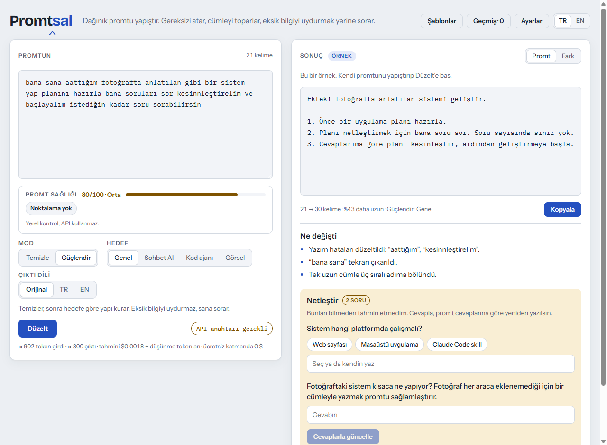

<div align="center">


**Promtsal dağınık bir promtu netleştirir. Gereksiz kelimeleri atar, cümleleri toparlar ve eksik bilgiyi tahmin etmek yerine sana sorar.**

[](https://cafu1107.github.io/promtsal/)

[](https://github.com/Cafu1107/promtsal/actions/workflows/pages.yml)
[](https://github.com/Cafu1107/promtsal/releases/latest)
[](LICENSE)


[English](README.md) · Türkçe

</div>



## Hızlı başlangıç

1. **[cafu1107.github.io/promtsal](https://cafu1107.github.io/promtsal/)** adresini aç.
2. [Google AI Studio](https://aistudio.google.com/apikey)'dan ücretsiz bir Gemini API anahtarı al ve **Ayarlar**'a yapıştır.
3. Promtunu yapıştır ve **Düzelt**'e bas (ya da <kbd>Ctrl</kbd> + <kbd>Enter</kbd>).

## Özellikler

| ✂️ Temizle ya da güçlendir | ❓ Tahmin etmez, sorar | 🩺 Promt sağlığı |
| --- | --- | --- |
| **Temizle** yazım hatalarını, dolgu kelimeleri ve tekrarları düzeltir, hiçbir şey eklemez. **Güçlendir** ayrıca promtu hedef yapay zekâya göre yapılandırır. | Eksik bilgiler önerilen cevaplarıyla birlikte soru olarak gelir. Cevaplarsan promt cevaplarına göre yeniden yazılır. | API çağırmayan yerel bir kontrol, yazarken dolgu, belirsiz ve tekrarlanan kelimelerin altını çizer ve 0–100 arası puan verir. |
| 🎯 **Hedefler** | 🔍 **Her değişiklik görünür** | 🔐 **Anahtarın sende kalır** |
| Genel, sohbet asistanları, kod ajanları (Claude Code, Cursor, Codex) ve görsel üreticiler (Midjourney, Flux, Higgsfield). | Fark sekmesi silinen kelimelerin üstünü çizer, eklenenleri vurgular. Kısa bir liste neyin neden değiştiğini söyler. | Sunucu yok. Anahtar tarayıcından doğrudan Google'a gider ve sen "hatırla" demedikçe yalnızca oturum boyunca tutulur. |
| 📋 **Şablonlar ve kurallar** | 💰 **Token ve maliyet** | 🌐 **Türkçe ve İngilizce** |
| Hazır şablonlar (hata, özellik, kod inceleme, özet, e-posta, karşılaştırma, görsel) ve kendi şablonların. Kalıcı kuralların her düzeltmede uygulanır. | Göndermeden önce tahmin, gönderdikten sonra gerçek token kullanımı ve maliyet. | Arayüz Türkçe ya da İngilizce. Çıktı orijinal dilde ya da çevrilmiş. |

## Ekran görüntüleri

| Fark görünümü | Telefon, koyu tema | Ayarlar |
| --- | --- | --- |
|  |  |  |

## Gizlilik ve güvenlik

- **Sunucu yok, takip yok, üçüncü taraf yok.** Promtsal fontları kendi içinde barındıran, GitHub Pages'te duran statik bir sayfa. Promtlar ve anahtar yalnızca `generativelanguage.googleapis.com` adresine gider.
- **Anahtar senin.** `sessionStorage`'da durur ve sekmeyi kapatınca silinir. Yalnızca **Bu cihazda hatırla**'yı işaretlersen `localStorage`'a geçer. Tek tıkla silinir. Bu siteye kısıtlanmış anahtarlar çalışır, çünkü Google'a sitenin kökeni gider (sayfa yolu asla gitmez).
- **Kilitli sayfa.** Sıkı bir Content Security Policy başka hiçbir adrese bağlantıya, satır içi scriptlere ve `eval`'e izin vermez. Trusted Types zorunludur, hiçbir şey HTML olarak basılmaz. Sayfa başka bir sitenin çerçevesi içinde çalışmayı reddeder.
- **Geçmiş isteğe bağlı.** Ayarlar'da **Geçmişi ve taslağı sakla**'yı kapatırsan yazdığın hiçbir şey saklanmaz.
- **Her push'ta kontrol.** CI yayından önce 30 test ve güvenlik kontrolü çalıştırır, sızmış anahtar arar. Actions commit SHA'sıyla sabitlenmiştir. CodeQL ve secret scanning repoyu izler.

Ayrıntılar ve sorun bildirme: [SECURITY.md](SECURITY.md).

## SSS

<details>
<summary><b>Ücretsiz mi?</b></summary>

Promtsal ücretsiz. Gemini API'nin günlük limitli ücretsiz bir katmanı var ve promt düzeltmek için genelde yeterli. Ücretli anahtar kullanırsan sayfa göndermeden önce tahmini, sonra gerçek maliyeti Google'ın yayımladığı fiyatlarla gösterir (fiyatlar en son 15 Ekim 2026'da kontrol edildi, değişebilir).
</details>

<details>
<summary><b>Google promtlarımla ne yapıyor?</b></summary>

Google, **ücretsiz katmanda** gönderilenleri ürünlerini geliştirmek için kullanabileceğini söylüyor. Ücretli katmanda kullanmıyor. Her iki durumda da şifre, kişisel veri ya da gizli bilgi gönderme.
</details>

<details>
<summary><b>Anahtarım geçersiz ya da engelli diyor.</b></summary>

Anahtarı AI Studio'dan eksiksiz kopyaladığını kontrol et. Google Cloud Console'da **Web siteleri** kısıtlaması eklediysen `https://cafu1107.github.io/*` adresini içermesi gerekir.
</details>

<details>
<summary><b>Claude ya da OpenAI kullanabilir miyim?</b></summary>

Web sitesi Gemini kullanıyor. Aynı kod claude.ai için tek dosyalık bir sayfaya da derlenebiliyor (`node scripts/build-artifact.mjs`). Orada açıldığında Claude'u senin claude.ai hesabınla kullanır, anahtar gerekmez.
</details>

<details>
<summary><b>Yazılımcılar için</b></summary>

Bağımlılık yok, site için derleme adımı yok.

```bash
cd web && python -m http.server 8000   # http://localhost:8000 adresini aç
node scripts/check.mjs                 # testler, i18n eşleşmesi, CSP kuralları, sır taraması
node scripts/build-artifact.mjs        # claude.ai için dist/promtsal.html
```

Proje yapısı ve kurallar [CONTRIBUTING.md](CONTRIBUTING.md) dosyasında.
</details>

## Katkı

Hata bildirimleri ve fikirler [Issues](https://github.com/Cafu1107/promtsal/issues) bölümüne. Kod katkısı için önce [CONTRIBUTING.md](CONTRIBUTING.md) dosyasını oku.

## Lisans

[MIT](LICENSE). Fontlar (Bricolage Grotesque, Instrument Sans, IBM Plex Mono) [SIL Open Font License 1.1](web/fonts/) ile birlikte sitede barındırılır.
